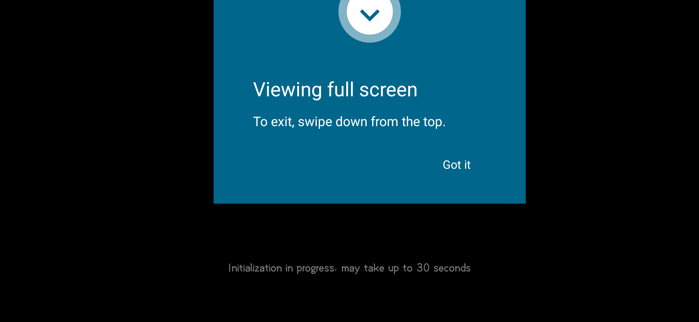

# APK2PC Studio

把 APK 一路走到底：**解包 → Java 源码 → 重建 → 对齐签名 → 在电脑上装好并跑起来**。
全部自动化，界面是本地网页，最终打包成**单个 EXE**，双击即用。

> 成品：`dist\APK2PCStudio\APK2PCStudio.exe`（onedir 目录形式，约 23 MB，无需 Python）
> 启动实测 **0.68 s**（旧的 onefile 单文件版是 2.80 s —— 每次都要把整个包解到临时目录）

## 已实测跑通的链路（本机 Windows 11 + JDK 21）

| 环节 | 结果 |
|---|---|
| apktool 解包 | ✔ 真实 APK：3769 个 smali、包名/启动 Activity 自动识别 |
| jadx 反编译 | ✔ 2327 个 .java（Maven 中央仓自动装配依赖） |
| apktool 重建 + aapt2 | ✔ 输出 unsigned.apk |
| zipalign + apksigner v1/v2/v3 | ✔ 证书校验通过 |
| 自建签名包装进 Android 14 模拟器 | ✔ Success（还自动处理了签名冲突：卸载旧的再装） |
| 真实游戏 APK 在电脑里启动 | ✔ 全屏进入应用 |
| **2.47 GB 真实游戏包（Phigros）重建+自签名** | ✔ 装机 Success → 进入游戏主界面 |
| 单文件启动器（APK 内嵌进 exe） | ✔ SHA-256 与原 APK 一致 |

## 界面



**apktool 重建 + 自签名**的 2.47 GB 真实游戏包，装进模拟器并跑起来：


---

## 先说实话：关于「APK 编译成 EXE」

APK 是 dex 字节码 + Android 框架 + JNI 原生库，Windows 上没有任何编译器能把它们
「翻译」成原生 EXE —— 这不是工具链选择问题，是运行时模型根本不同。
市面上所有「APK 转 EXE」的产品，本质都是**把 Android 运行时塞进电脑**，EXE 只是个壳。

所以本工具的做法是（也是唯一靠谱的做法）：

```
你的 APK ──► ① apktool 解包（资源 + smali）
            ② jadx 反编译出可读 Java 源码
            ③ apktool 重建 APK（改过 smali/资源后仍然能出包）
            ④ zipalign + apksigner 签名（Android 11+ 强制 v2，不签名装不上）
            ⑤ adb 装进电脑里的 Android 模拟器并拉起
```

「编译成 EXE 在电脑运行」这一步由 **⑤ 实现**：程序自动下载并管理一台 Android 模拟器，
APK 真的跑在 Windows 里（模拟器窗口）。另外还能为某个 APK 生成**独立 EXE 启动器**：
APK 直接内嵌在这个 exe 的尾部（布局：`[APK][JSON][json长度][MAGIC]`），
双击它 → 自动开机 → 自动装包 → 全屏拉起。产物是**一个文件**，不用旁边再放 apk，
思路与 [APK2EXE](https://github.com/doxo46/APK2EXE-) 一致（它用 WSA，本工具用 AVD 模拟器）。

想要原生性能，只能在下面二选一（本工具不代做）：
- 用 Android-x86 / BlissOS 装物理机或 VMware，再装 APK；
- 有源码的前提下用 Flutter / React Native / Qt 重写。

---

## 快速开始

### 方式 A：直接跑源码

```bat
python app.py
```

浏览器会自动打开 `http://127.0.0.1:<随机端口>/`。

**环境要求**：Windows 10/11 + JDK 11（apktool 3.x 要求）。
其余组件（apktool.jar / jadx / build-tools / 模拟器与系统镜像）**都不入库**，
首次在界面里点「装配」时按需下载到 `%LOCALAPPDATA%\APK2PCStudio\tools\`。
源码本身零第三方 Python 依赖（只用标准库）。

### 方式 B：打包

```bat
打包EXE.bat            :: 默认 onedir（快）
打包EXE.bat --onefile  :: 单文件分发（启动慢 2 秒）
```

或 `python build_exe.py [--onefile]`。

| 形态 | 产物 | 启动 |
|---|---|---|
| onedir（默认） | `dist/APK2PCStudio/APK2PCStudio.exe` + `_internal/` | **0.68 s** |
| onefile | `dist/APK2PCStudio.exe`（单文件，9.4 MB） | 2.80 s（每次解包 + 杀软扫描） |

> 注意：onedir 生成「独立启动器」时是把整个目录复制过去（exe 依赖 `_internal`）；
> 想要「一个文件里塞着 APK」，用 `--onefile` 构建后再导出启动器。

---

## 界面怎么用

1. **目标 APK** —— 点「浏览…」选文件（弹系统对话框），或直接粘贴路径回车。
   「解析」会先读包名 / dex 数量 / ABI，并提示是否加固壳。
2. **工具链** —— 7 项状态一目了然。缺什么点旁边「装配」：
   - `jadx`：约 40 MB，Java 源码反编译
   - `Build-Tools`：约 58 MB，zipalign + apksigner
   - `Android 模拟器 + 系统镜像`：约 1.5–2 GB，第一次要等
3. **一键全流程** —— 六步全自动，日志实时滚动，中途可取消（会杀掉子进程）。
4. **产物** —— 只做局部操作也可以：`仅解包+Java` / `仅 Java` / `重建签名` / `直接运行`。

---

## 目录与产物

```
%LOCALAPPDATA%\APK2PCStudio\
├─ tools\            jadx / build-tools / apktool.jar（自动下载）
├─ android-sdk\      cmdline-tools / emulator / system-images / platform-tools
├─ workspace\        每次任务一个目录
│   └─ <应用名>_<时间>\
│       ├─ src\      apktool 解包结果（可改 smali / res）
│       ├─ java\     jadx 反编译的 Java 源码
│       ├─ *-unsigned.apk
│       ├─ *-aligned.apk
│       ├─ *-signed.apk   ← 可直接安装
│       ├─ gradle-project\   Android Studio 工程骨架（导出时生成）
│       └─ launcher\          独立 EXE 启动器（导出时生成）
├─ apk2pc-debug.keystore     自动生成的签名密钥（密码 android）
└─ settings.json
```

---

## 命令行

```bat
APK2PCStudio.exe                  # 打开界面
APK2PCStudio.exe --launch "x.apk" # 直接跑某个 APK 的全流程
APK2PCStudio.exe --no-browser     # 只起服务
APK2PCStudio.exe --port 8760      # 固定端口
APK2PCStudio.exe --headless-install  # 只装配工具链（CI / 首次准备）
```

启动器模式下，EXE 会读取**同目录同名**的 `xxx.apk2pc.json`：

```json
{ "apk": "D:\\games\\demo.apk", "label": "demo", "fullscreen": true }
```

---

## 已知限制（诚实清单）

| 情况 | 表现 | 原因 |
|---|---|---|
| 模拟器第一次开机 | 仍需 60–110 s | 没有可用快照，只能冷启；之后走快照 10 s 级 |
| 快照损坏/失效 | 启动约 90 s 后自动冷启重试 | 装过新应用或强杀过模拟器时会发生，属正常兜底 |
| 加固壳（360/腾讯乐固/梆梆） | 解包后 smali 为空、Java 反编译无产出 | dex 被壳加密，apktool/jadx 看不到 |
| jadx 输出的 Java | 不能直接 `gradle build` 通过 | 混淆、内联、资源 id、native 依赖 |
| 重签名后安装失败 | 需先卸载原版 | 签名不一致，Android 会拒绝覆盖 |
| 模拟器起不来 | 提示 WHPX 未启用 | 需在「启用或关闭 Windows 功能」开 **Windows 虚拟机监控程序平台** |
| 大游戏（2 GB+） | 解包/重建慢，占磁盘 | 属于正常耗时 |
| 2 GB 级 APK 装机 | `INSTALL_FAILED_INSUFFICIENT_STORAGE` | AVD 数据分区默认 8G；早期建的 AVD 是 6G，需改 `config.ini` 的 `disk.dataPartition.size` |
| 主机 C 盘吃紧 | 建不出 AVD 镜像（`Not enough space to create userdata partition`） | AVD 镜像 + 解包产物都很占；成品建议放 D 盘 |

> 提示：本工具适合处理**你自己拥有合法授权**的应用（自研、开源、内部包、二次开发）。
